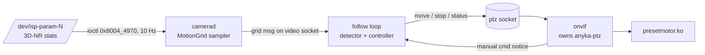

# Follow Movement — Design & Research

Status: **draft, awaiting approval** (spec: `spec.md`). Nothing verified on hardware yet.

## 1. Research findings

Sources follow the Knowledge Verification Chain: codebase → repo docs → web. Items marked ⚠ are unverified.

### 1.1 Hardware acceleration available on AV100

| Capability | Verdict | Evidence |
| --- | --- | --- |
| **ISP motion grid (3D-NR stats)** | ✅ **Use.** 32×24 `u16` energy per cell, computed by the ISP, costs one ioctl. | `libplat_vpss.so` `ak_vpss_md_get_stat` → `isp_get_statinfo(dev, 32, buf[0x608])` → `AK_ISP_get_3d_nr_stat_info` → `isp_sdk_ioctl` cmd `0x8004_4970`, wrapped in `VIDIOC_S_PARM {type=1, cmd, ptr}` on `/dev/isp-param-N`; grid = `buf+2`, 1536 B (disassembly). Same path as `Sensor::isp_command` (`crates/anyka-av100/src/device.rs:172-185`, `v4l2.rs:75-81`). ⚠ never read on hardware. |
| Grid rows actually valid | ⚠ Stock `ipc` passes `len=16` rows. Hypothesis: at 1280×720 the cells are 40×45 px, so 32×16 cover the frame. Verify by capture. | `references/ak3918ev200/vendor/decompiled/ipc.c` ~20300 `_process_mt_event` |
| `/dev/isp-stats-3dnr-N` (mmap/poll) | Possible zero-copy, event-driven alternative; kernel ABI not decoded. Phase 2 optimization. | `ls_dev.txt:14-21`; `drivers/ak_isp/facts.md:150-158` (`isp_stats_file_mmap/poll`, `camera_copy_md`) |
| 3D-NR `md_th` / `motion_filter` | Tunable in ISP; may sharpen the grid. Keep vendor defaults first. | `sdk/v8/include/ak_vpss.h:430-433` |
| Hardware scaler (3rd ISP node `video-N-2`) | Fallback source: a 320×180 NV12 stream at no CPU cost if the grid proves too coarse. Never tried. | `device.rs:40,221-223`; code sets up node 1 only (`lib.rs:98-103`) |
| Encoder motion vectors / SAD | ❌ Not exposed. | AV100 `venc.rs:269-272` result = kaddr/len/ts/seq/kind only |
| NPU/SVP person detection | ❌ No `/dev/npu`, no runtime/models. | `docs/notes/RUST-REWRITE-ESTIMATE.md:198` |
| IVE / 2D accel / TDE | ❌ Not found. | — |
| CPU | ARM926EJ-S, `edsp` (QADD, SMULxy, PLD), **soft-float, no NEON**. | `proc_cpuinfo.txt:3-4`; `.cargo/config.toml` |

### 1.2 Vendor reference algorithm (for the Rust port, not linked)

The stock EV200 `ipc` pairs the grid with `libak_mt.so` ("MT Lib V1.0.07", `sdk/include/ak_mt.h:206-234`). The V8/AV100 `ipc` uses `ak_mrd_*` (`sdk/v8/include/ak_mrd.h`).
- **Loop:** get stat → `ak_mt_tracking` → `turn_to_pos` → wait for the PTZ → `update_camera_angle` (`akv300-extract/.../mt_demo/ak_mt_demo.c`).
- **Stock tuning:**
  - Range 0–350° × 0–65°, home (180, 65).
  - MRD filters 12000/8000 (big/small).
  - 5–7 decision frames.
  - Region params min 10 / max 300 cells, `bh=10`, `bv=8`.
  - AV100 `ipc` uses `motion_tracking_step_per_angle_x/y = 55/38` (`docs/notes/PRESET-MOTOR-ABI.md:203`).
- **Decompiled reference:** `references/ak3918ev200/vendor/decompiled/libak_mt.so.c` (2188 lines). Port the decision logic and constants from it; don't copy code verbatim.

### 1.3 Algorithm practice (web)

- **Grid-based detection is standard on cheap SoCs.** Ingenic T31's IVS "move" interface also works on a grid of cells, one result each. Wyze Pan follows the largest moving object and returns home after 15 s (support.wyze.com 4407141515547).
- **The camera's own motion causes most false positives.** Frigate pauses detection during moves (docs.frigate.video/configuration/autotracking). daygle PR #491 re-seeds the background after a pan. The vendor uses `wait_camera_rotation`.
- **Soft-float cost.** Whetstone on an ARM926 runs about 18.7× slower without a VFP (twoerner.blogspot.com 2019/10). Use integer maths per cell and allow at most a few floats per decision.
- **Rust crates.**
  - `fixed`: OK if Q-format is needed.
  - `pid`: float-only (`FloatCore`). Not worth it; P/PI with a dead zone is about 20 lines of integer code.
  - `imageproc`: too heavy, float-based, and unverified on armv5te.
  - Connected components on 768 cells is about 50 lines of code with no dependencies.

### 1.4 PTZ constraints (`docs/notes/PRESET-MOTOR-ABI.md`)

- **Mechanics:** open-loop steppers with no feedback and software limits only. Pan 0..175 and tilt 0..70 user steps.
- **Speed:** one speed for both axes, about 20 steps/s (50 ms per step). A full pan takes about 8.75 s.
- **Status:** `run_status` maps to `Position.moving`. Poll it at no more than 20 Hz.
- **Ownership:** only `onvif` owns the motors; everyone else goes through the `ptz` socket (`ptz-proto`).
- **Untested:** motion has **never been commanded on hardware** (HARDWARE-FINDINGS.md:519), so this blocks FOL-09..13 verification.

### 1.5 Budget (HARDWARE-FINDINGS.md:492-501, CONCERNS.md)

- **RAM:** MemAvailable is about 14 MB of 32 MB. Each small Rust service uses 1.6–3.3 MB RSS. Free RAM has dipped to about 500 KB before.
- **Fragmentation:** the encoder oopses when memory is fragmented. Use fixed-size buffers only, allocate at startup, never grow.
- **Not measured yet:** CPU % per service and `camerad` RSS. Measure before and after (spec goal: ≤5 % CPU, ≤1 MB RSS).

## 2. Recommended approach (ranked optimizations)

1. **Detect from the ISP grid, not pixels.** The data is 1.5 KB per poll instead of 1.4 MB of luma, so per-poll work is about 768 integer ops: microseconds, not milliseconds.
2. **Poll at 10 Hz, not 100 Hz like the vendor.** Walking subjects at 20 steps/s don't need more, and it cuts syscalls 10×.
3. **Pause detection while the motors run.** This saves CPU and avoids chasing the camera's own motion.
4. **Integer-only per-cell path:**
   - Running baseline `bg += (cur-bg) >> 3` in `u16`/`i32`.
   - Hysteresis thresholds.
   - Flood fill with a fixed `[u16; 32]` stack bitmap.
   - Centroid as `Σx·w / Σw` in `u32`.
5. **Static allocation.** Grid, baseline, label map and fill stack are fixed arrays, about 6 KB total. No `Vec` in the loop.
6. **Take only the decision at 1–2 Hz from detection to PTZ.** A move takes 0.5–3 s anyway; decision frames (5 at 10 Hz = 0.5 s) set this naturally.
7. **Phase 2:** replace polling with poll()/mmap on `/dev/isp-stats-3dnr-N` once its ABI is decoded, giving zero-copy, event-driven grids.
8. **Fallback (only if the grid is too coarse):** 3rd ISP node at 320×180 Y8 subsampled 4× → 80×45 frame difference. Check the cache attributes of the MMAP buffers first, since reading uncached memory is slow.

**Compute estimate (unmeasured ⚠):** each grid needs about 768 × (sub + compare + baseline update) plus a flood fill, roughly 5–10 k instructions or about 25 µs at 400 MHz. At 10 Hz that is ≪ 0.1 % CPU. The ioctl syscall dominates.

## 3. Architecture

### Components

| Component | Location | Purpose | Reuses |
| --- | --- | --- | --- |
| `MotionGrid` reader | `crates/anyka-av100` (`device.rs`, next to `isp_command`) | One ioctl into a fixed `[[u16;32];24]` | `Sensor::isp_command`, `v4l2::private` |
| Backend trait method | `crates/camera` `backend.rs` | `fn motion_grid(&self) -> Option<MotionGrid>`; returns `None` on V4L2 boards (fallback in Phase 3) | backend split (CAM-01..05) |
| Grid publisher | `crates/camerad` | Samples at the configured Hz and sends on the video socket | `video-proto` message types |
| `motion` crate (new, generic, no SDK, host-testable) | `crates/motion` | Baseline, hysteresis, connected components, target persistence, global-change detection | — |
| `follow` controller | `crates/motion::follow` or `crates/follow` | State machine (Idle → Tracking → Settling → Returning / Paused), dead zone, proportional step, soft limits | `ptz-proto` client, `ntp::backoff`-style retry |
| Fixtures + replay tool | `crates/motion/tests/fixtures`, `tools/` | Grids recorded on the AV100 for regression tests; ASCII heat map | — |

### Gray area to decide (before Tasks)

**Where does the follow loop run?**
- **(A) Thread inside `camerad`:** about 0 MB extra RSS, but it couples the video producer to PTZ.
- **(B) Separate `follow` service:** about 1.6 MB RSS, isolated, restartable by the supervisor, with the grid coming over the video socket. It fits the project's one-service-per-concern pattern.
- **(C) Inside `onvif`, which owns the motors:** no socket hop for PTZ, but it needs the grid from `camerad` anyway.
- **Recommendation: B.** 1.6 MB of the 14 MB headroom is acceptable, and it's isolated. Fall back to A if measured headroom says otherwise.

## 4. Verification plan

1. **Spike T0 (hardware):** read the grid via ioctl on the live AV100, dump 60 s of ASCII heat maps while walking, and confirm the valid rows (16 vs 24) and value ranges. Gates everything else.
2. **Spike T0b:** first PTZ move on hardware via `ptz-proto` (separate blocker, HARDWARE-FINDINGS:519). Measure degrees/step against the vendor's 55/38.
3. Host unit tests on recorded fixtures (detector, global change, persistence).
4. Controller tests against `anyka-ptz` `sim.rs`.
5. Budget check: `top` CPU and RSS for `camerad` + `follow` before and after, plus a 1 h idle false-move test.

## 5. Risks

| Risk | Mitigation |
| --- | --- |
| The ioctl layout differs on AV100's driver (disassembly is from V8 `libplat_vpss`) | Spike T0 first; also check `ak_isp_get_mdinfo` in the kernel facts |
| Grid too coarse at long range | Fallback to the 3rd ISP node at 320×180 |
| PTZ never exercised; open-loop steps drift | Home on start; re-home after N moves; respect soft limits |
| Day/night IR switch looks like global motion | FOL-07 global-change rejection plus baseline re-seed |
| Memory fragmentation and encoder oops | Fixed buffers allocated at start; separate process doesn't touch the ION/encoder |
